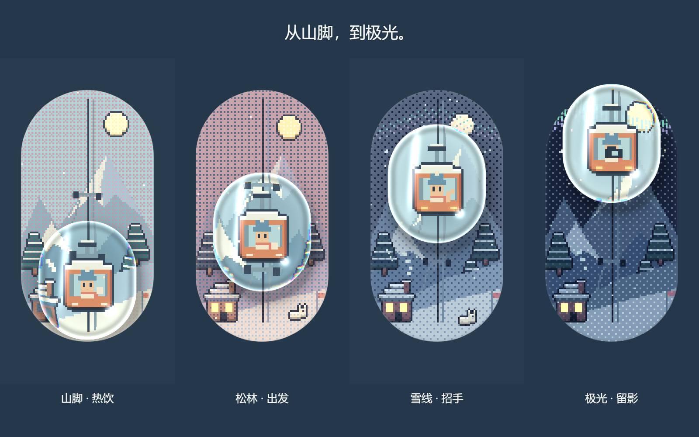

# Winter Volume · 竖向冬日音量键

把一段像素冬天装进音量键：向上拖动，玻璃滑块带着缆车和小人从山脚升到极光处。沿途有热饮、招手、拍照、亮窗、雪兔和飘雪，房间颜色也随音量从雪日变为冬夜。

目标仓库：[deep-alain/winter-volume](https://github.com/deep-alain/winter-volume)。本仓库包含竖向版本源码、本地媒体导出工具，以及可直接用于 X 的成片和配图；未代发到 X，也未部署网站。



## 视频与配图

- [竖版循环视频](out/x-vertical/winter-volume-portrait-loop.mp4)：1080×1350，12 秒，30 fps。
- [方版循环视频](out/x-vertical/winter-volume-square-loop.mp4)：1080×1080，同内容。
- [完整素材包](out/冬日音量键-X素材包.zip)：两个 MP4、四张 PNG、使用说明和中英文发帖文案。
- 四张配图：[极光封面](out/x-vertical/cover-1080x1350.png)、[山脚日景](out/x-vertical/day-1080x1350.png)、[玻璃近景](out/x-vertical/detail-1080x1080.png)、[阶段拼图](out/x-vertical/stages-1600x1000.png)。

视频保留真实 WebGL 玻璃效果，带原创合成风声、缆车低鸣和山顶铃音。画面与音轨的首尾接缝均经过检查，详情见 [媒体检查报告](out/x-vertical/media-check.json)。

## 本地运行

需要 Node.js 22.18+。

```sh
git clone https://github.com/deep-alain/winter-volume.git
cd winter-volume
npm ci
npm run dev
```

本地页面为 `http://127.0.0.1:4174/`。向上拖动增大音量；方向键调节，Shift 加速，Home / End 到两端，Enter / Space 切换端点。`?demo=1` 播放指针演示，`?t=4.2` 显示固定帧。

```sh
npm run build
npm run lint
npm test
```

## 重新导出素材

`npm ci` 同时安装离线媒体工具的开发依赖。浏览器页面本身仅依赖 React，不加载外部图片、字体或网络资源。

```sh
npm run media:serve
```

打开本地 `http://127.0.0.1:4175/media.html`，点击“导出视频帧与配图”，等待完成后执行：

```sh
npm run media:encode
npm run media:check
```

中间帧保存在忽略目录 `.local/vertical-frames/`，成片和检查报告写入 `out/x-vertical/`。成片使用 12 秒周期，缆车在 2.4 秒内顺滑上升，到顶停留后下降；雪花保持向下运动，通过画外循环进入。

## 实现

- Vite、React 19、严格 TypeScript 和原生 CSS。React 只挂载引擎，逐帧更新不经过 React state。
- CPU 绘制 76×144 像素世界；固定 xorshift 种子，nearest-neighbour 整数倍率显示。
- 四组材质光照与 4×4 Bayer 有序抖动；发光像素另存缓冲。
- 单个 WebGL2 片元着色器绘制玻璃放大、弯折、色散、高光与阴影；无 WebGL2 时降级为 2D Canvas。
- 弹簧跟随、等面积伸缩与轻摆；支持减弱动态、深色偏好、原生 range 键盘操作和状态播报。
- `window.__render(t)` 从固定种子按 60 fps 重建场景，支持确定性取帧。

`src/` 是场景与交互，`tools/` 是媒体构图、导出、编码和检查，`tests/` 覆盖运动、世界、生命周期和循环时序。[中文详细说明](out/说明.md) 记录概念、分层与验证边界。

当前实现是视觉音量控件，尚未连接系统音量或实际音源。手机布局已做浏览器视口检查，实体触屏手势尚未验证。
